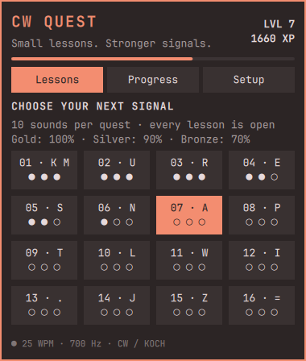
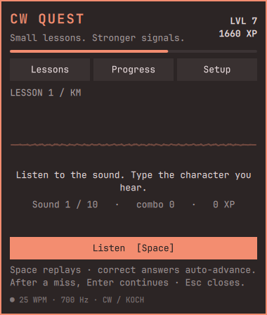
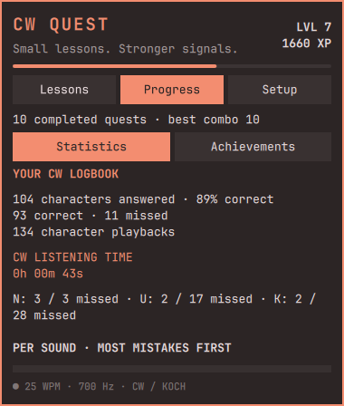
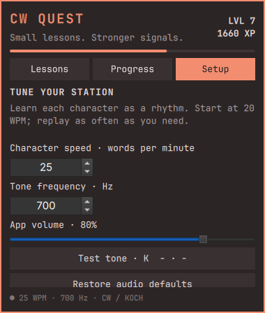

# `·−` Omarchy CW Quest

Got a minute while your agents are working? Why not squeeze in some Morse code training?

A native Omarchy bar plugin for learning Morse by ear. The game rules, audio synthesis, and persistence are written in **JavaScript**. QML supplies the native Quickshell interface required by Omarchy plugins.

This project was inspired by the Koch lessons in [CW Trainer](https://spasutto.github.io/cw-trainer/).

## Install

```bash
omarchy plugin add https://github.com/lb6eh/omarchy-cw-quest.git --enable
```

Click the `·−` bar icon to start training.

### Keyboard shortcut

To open or close CW Quest with **Super+Ctrl+M** (Command+Ctrl+M on Apple keyboards), add this line to `~/.config/hypr/bindings.lua`:

```lua
o.bind("SUPER + CTRL + M", "CW Quest", "omarchy-shell lb6eh.cw-quest toggle")
```

Hyprland reloads the binding when you save the file. Check `omarchy menu keybindings --print` first to make sure the shortcut is free on your system.

## Screenshots

Captured from the running Omarchy plugin. Colors follow your active theme.

| Choose a lesson | Train by ear |
| --- | --- |
|  |  |

| Listening statistics | Audio setup |
| --- | --- |
|  |  |

## Play

- Select any of **40 Koch lessons**. Lesson 1 starts with K and M; each subsequent lesson adds one character.
- Each quest contains **10 sounds**. Click **Listen** or press **Space**, then type the character you hear. Correct answers show feedback for one second, then automatically play the next sound. After a mistake, use **Enter** to continue. On the completion screen, **Enter** starts the next lesson (including keypad Enter).
- Correct answers earn XP; consecutive correct answers earn streak bonuses. A mistake resets the current streak to zero. A score of at least 90% adds a 30 XP completion bonus.
- Earn bronze at 70%, silver at 90%, and gold at 100%. Your best medal remains saved when you replay a lesson.
- Finish any quest for a short confetti burst and “GJ” (good job) in Morse, played at your current audio settings. Volume 0 silences the celebration too.
- Track levels, completed quests, your longest correct streak, and 18 achievements in **Progress**. The streak record is your most consecutive correct answers within a completed quest (up to 10).
- Jump between lessons whenever you like. Leaving an unfinished round discards that round; completed progress remains saved.

There is no countdown. Replays are unlimited. Listen to whole rhythms rather than counting dots and dashes. This version teaches individual characters; it does not yet provide word, callsign, or QSO exercises.

Achievements include **Local woodpecker**, **Morse before chores**, **Human modem**, and **All your beeps belong to us**. Unlocks are calculated from saved progress, so existing medals and quests count automatically. Each achievement shows its requirement in **Progress**.

## Lesson recaps and statistics

Each finished quest shows accuracy, correct/total answers, character playbacks, CW listening time, and the sounds missed most. **Progress → Statistics** combines all lessons, with per-character attempts, mistakes, accuracy, playbacks, and listening time. Rows sort by most mistakes; ties favor lower accuracy. Replays count as playbacks, not new answers. Answers in unfinished quests count too.

## Audio setup

Open **Setup** to adjust character speed (5–50 WPM), tone (300–1200 Hz), and app volume. Defaults are **20 WPM, 700 Hz, 80% app volume**.

## Saved data and removal

Settings and completed progress are stored in `$XDG_STATE_HOME/omarchy-cw-quest/profile.json`, or `~/.local/state/omarchy-cw-quest/profile.json` when that variable is unset. Writes are atomic and profile files use owner-only permissions. Use **Setup → Reset lesson progress** and confirm **Yes, reset progress** to clear XP, medals, achievements, completed quests, and statistics while keeping audio settings. Completed rounds are rewarded once by the interface; in-progress rounds are intentionally not persisted.

Remove the plugin with `omarchy plugin remove lb6eh.cw-quest`. Saved progress remains available for a future installation.

## Development

Requires Node.js 22 or newer. Runtime audio requires `paplay` (the `libpulse` package) and a working PulseAudio-compatible server, such as PipeWire Pulse. These are normally included with current Omarchy installations. There are no npm dependencies or build steps.

```bash
npm test                       # Lessons, scoring, PCM audio, persistence
npm run check                  # JavaScript syntax
omarchy plugin validate .      # Manifest and entry points
```

`Trainer.js` is shared between QML and Node tests. `Panel.qml` renders the game, `BarWidget.qml` connects to Omarchy, and `helpers/` contains Node audio and state helpers. Keep JavaScript indentation at two spaces. Format QML with `qmlformat -i -w 2 BarWidget.qml Panel.qml` when available. Never edit the packaged shell under `/usr/share/omarchy/`.
